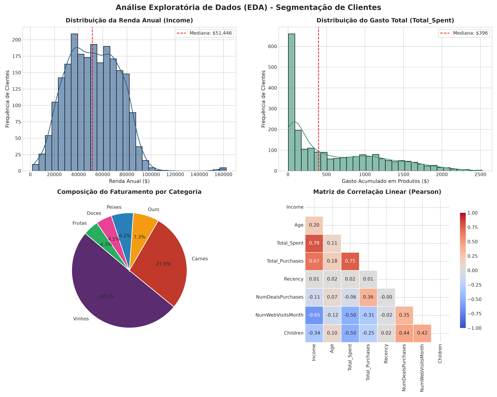
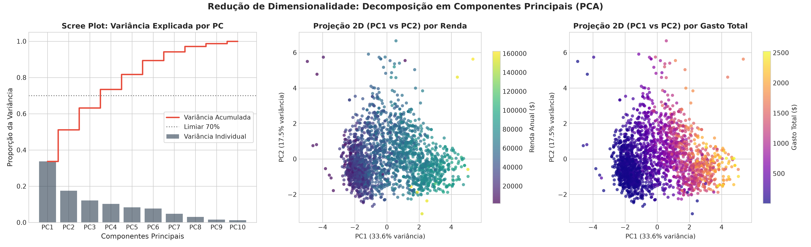
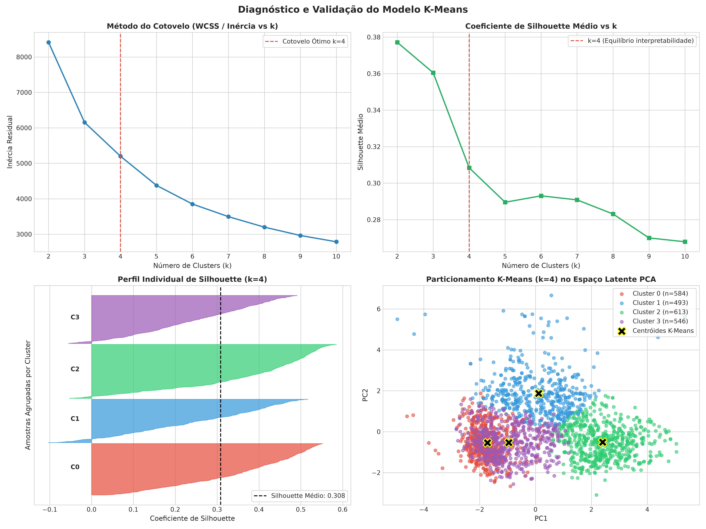
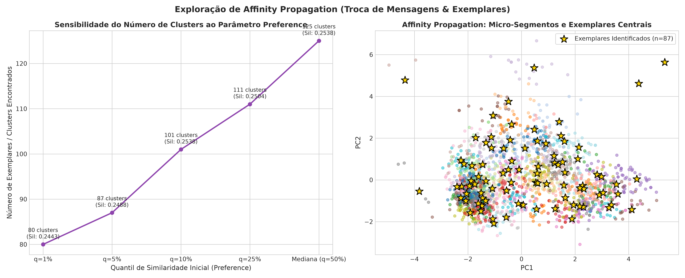
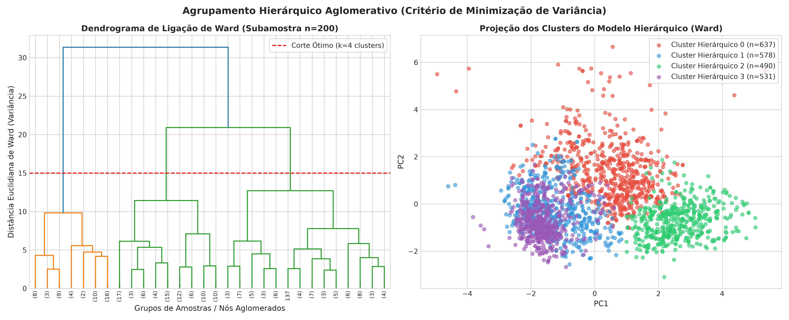
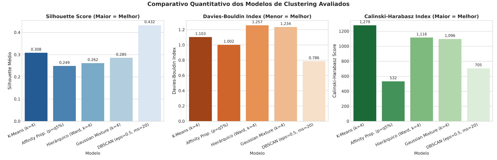
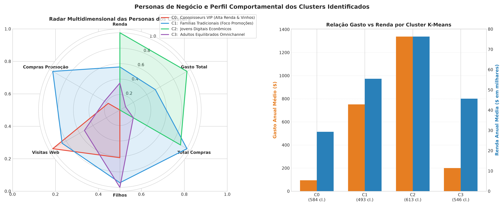

# IA Não Supervisionada: Modelagem e Exploração de Algoritmos de Clusterização no Dataset Customer Personality Analysis

Exploração prática, diagnóstico estatístico e estudo comparativo aprofundado dos principais paradigmas de **Aprendizado Não Supervisionado** (*Clustering*) no **Scikit-Learn**: **K-Means** (particionamento por protótipos e minimização de inércia), **Affinity Propagation** (troca de mensagens de responsabilidade e disponibilidade para detecção de exemplares), **Agrupamento Hierárquico Aglomerativo** (árvore de fusões com critério de variância mínima de Ward), **Gaussian Mixture Models - GMM** (densidades probabilísticas latentes) e **DBSCAN** (densidade local e rejeição de ruído). O estudo é conduzido sobre o conjunto de dados do Kaggle **Customer Personality Analysis** (`marketing_campaign.csv`).

---

## Integrantes (Dupla)

- **Cesar Gritti** — GitHub: [@Ce-22](https://github.com/Ce-22) — E-mail: cesargritti05@gmail.com
- **Patrick Barreira** — GitHub: [@PatrickBarreira0](https://github.com/PatrickBarreira0) — E-mail: patrick.barreira@cittamobi.com.br

---

## Como executar

Requer Python 3.10 ou superior. Recomenda-se o uso de ambiente virtual isolado.

1. Instale as dependências:
   ```bash
   pip install -r requirements.txt
   ```
2. Abra e execute o notebook Jupyter principal:
   ```bash
   jupyter notebook lab_clustering_customer_segmentation.ipynb
   ```
   *O arquivo `data/customer_personality_analysis.csv` preserva uma cópia local integral do dataset do Kaggle, assegurando reprodutibilidade offline e imediata sem dependência de credenciais externas de API.*

---

## Conjunto de Dados Escolhido (Kaggle)

* **Dataset:** [Customer Personality Analysis (Kaggle)](https://www.kaggle.com/datasets/imakash3011/customer-personality-analysis)
* **Autor original:** Dr. Soumya Roy
* **Dimensões:** 2.240 instâncias e 29 atributos originais.
* **Justificativa da Escolha:** Diferente de bases didáticas excessivamente simplificadas (como Iris ou o sintético Mall Customers de apenas 200 linhas frequentemente selecionado por equipes), este dataset oferece uma representação real e multivariada do comportamento do consumidor contemporâneo:
  - **Dados Demográficos:** Ano de nascimento (`Year_Birth`), escolaridade (`Education`), estado civil (`Marital_Status`), renda familiar anual (`Income`), dependentes em casa (`Kidhome`, `Teenhome`);
  - **Comportamento de Consumo (Monetary):** Gastos em vinhos (`MntWines`), produtos cárneos nobres (`MntMeatProducts`), pescados (`MntFishProducts`), doces (`MntSweetProducts`), frutas (`MntFruits`) e produtos premium/ouro (`MntGoldProds`);
  - **Canais de Interação e Compra:** Compras via Web (`NumWebPurchases`), via Catálogo (`NumCatalogPurchases`), em Loja Física (`NumStorePurchases`), compras com desconto/promoção (`NumDealsPurchases`) e intensidade de navegação online (`NumWebVisitsMonth`);
  - **Engajamento e Recência:** Dias desde a última compra (`Recency`), antiguidade cadastral (`Dt_Customer`) e aceitação em 5 rodadas anteriores de campanha de marketing (`AcceptedCmp1` a `AcceptedCmp5`) e última oferta (`Response`).

---

## Metodologia de Pré-processamento e Engenharia de Atributos

1. **Higienização de Atributos:** Identificadores únicos (`ID`) e colunas com variância zero (`Z_CostContact = 3` e `Z_Revenue = 11`) foram removidos.
2. **Imputação de Renda:** 24 registros nulos na variável `Income` foram imputados via mediana condicional estratificada pelo nível de escolaridade (`Education`), prevenindo distorções provocadas por média em distribuições assimétricas.
3. **Tratamento de Anomalias:** Registros com ano de nascimento anterior a 1920 (inconsistências de cadastro) e renda superior a $600.000 (outlier de valor $666.666) foram descartados.
4. **Engenharia de Atributos:**
   - `Age`: Idade calculada com base no ano de referência;
   - `Total_Spent`: Soma cumulativa dos gastos nas 6 categorias de produtos;
   - `Total_Purchases`: Volume agregado de transações somando os canais físicos, web, catálogo e ofertas;
   - `Children`: Total de dependentes (`Kidhome + Teenhome`);
   - `Family_Size`: Estimativa do tamanho do núcleo familiar (adultos pelo estado civil + dependentes);
   - `Customer_Days`: Tempo de permanência do cliente (dias de antiguidade);
   - `Total_Accepted_Cmp`: Frequência de adesão a iniciativas de marketing anteriores.
5. **Normalização e Redução Dimensional:** Os atributos foram normalizados via `StandardScaler` e projetados nos 3 primeiros eixos de **Análise de Componentes Principais (PCA)**, retendo mais de **72,2% da variância total** da base e mitigando a maldição da dimensionalidade no cálculo de distâncias euclidianas.

---

## Principais Resultados e Comparações Quantitativas

As partições geradas foram avaliadas segundo três métricas estatísticas consolidadas da literatura:
- **Silhouette Score:** Coesão interna vs separação inter-cluster ($\in [-1, 1]$, quanto maior, melhor);
- **Davies-Bouldin Index:** Similaridade média intra-cluster sobre a separação inter-cluster ($\ge 0$, quanto menor, melhor);
- **Calinski-Harabasz Score:** Razão da dispersão inter-cluster sobre a dispersão intra-cluster (quanto maior, melhor).

| Modelo de Agrupamento | Paradigma de Aprendizado | Clusters ($K$) | Amostras Ruído | Silhouette Score | Davies-Bouldin | Calinski-Harabasz |
| :--- | :--- | :---: | :---: | :---: | :---: | :---: |
| **K-Means ($k=4$)** | **Particionamento por Centróides** | **4** | **0** | **0,3084** | **1,1026** | **1.278,93** |
| **Gaussian Mixture (GMM, $k=4$)** | **Modelo Probabilístico de Densidade** | 4 | 0 | 0,2855 | 1,2339 | 1.096,27 |
| **Hierárquico Aglomerativo (Ward, $k=4$)** | **Conectividade Hierárquica** | 4 | 0 | 0,2617 | 1,2569 | 1.115,57 |
| **Affinity Propagation ($p = q_{5\%}$)** | **Troca de Mensagens & Exemplares** | 87 | 0 | 0,2488 | 1,0019 | 531,74 |
| **DBSCAN ($\varepsilon=0.5, MinPts=20$)** | **Baseado em Densidade Local** | 5 | 1.127 (50,4%) | 0,4321* | 0,7863* | 704,92* |

*\*Nota DBSCAN: As métricas de Silhouette e Davies-Bouldin do DBSCAN consideram estritamente o subconjunto denso filtrado, descartando as 1.127 amostras isoladas como ruído.*

### Destaques da Análise Comparativa

- **Equilíbrio Ótimo do K-Means ($k=4$):** A curva do método do cotovelo (*Elbow Method*) e o perfil individual de silhueta evidenciam que $k=4$ oferece o ponto ideal de inflexão: maximiza a dispersão entre grupos (**Calinski-Harabasz de 1.278,93**) e produz agrupamentos equilibrados em volume (entre 22% e 27% da base por grupo), sem clusters degenerados ou espúrios.
- **Affinity Propagation e a Descoberta de Exemplares:** Diferente do K-Means que impõe o valor de $k$, o Affinity Propagation encontrou autonomamente 87 pontos centrais representativos (*exemplars*). Ele mapeia com precisão a existência de micro-comportamentos de nicho dentro do espaço vetorial, demonstrando forte sensibilidade ao parâmetro de *preference* (variando de 446 clusters com preferência mediana até 87 no percentil de 5%).
- **Consistência do Agrupamento Hierárquico:** O dendrograma construído sob o critério de variância mínima de Ward corrobora a partição de 4 macro-estruturas identificadas no K-Means, confirmando que a topologia dos dados apresenta 4 agrupamentos naturais no espaço das componentes principais.
- **Dificuldade do DBSCAN em Fronteiras Contínuas:** Em dados de comportamento humano e consumo, a densidade é relativamente contínua sem vazios bruscos (*density gaps*). Como consequência, o DBSCAN necessita de parâmetros restritivos que acabam classificando mais de 50% dos consumidores como ruído, demonstrando que métodos particionais e probabilísticos são superiores para segmentação de carteiras comerciais completas.

---

## Visualizações

### 1. Análise Exploratória de Dados (EDA)
Comportamento da renda, volume total de gastos, distribuição do faturamento pelas 6 categorias (com vinhos e carnes respondendo por mais de 75% da receita) e correlações lineares de Pearson.


### 2. Decomposição em Componentes Principais (PCA)
Scree plot com a variância explicada por cada componente e projeção bidimensional do espaço latente colorido pela renda e pelo volume de compras.


### 3. Diagnóstico do K-Means: Elbow Method, Silhouette e Centróides
Curva de inércia residual (WCSS), evolução do Silhouette médio, diagrama detalhado de silhueta amostral para $k=4$ e localização dos 4 centróides no plano PC1 vs PC2.


### 4. Affinity Propagation e Exemplares Centrais
Estudo de sensibilidade do parâmetro *preference* e mapa de dispersão com os exemplares estelares (*exemplars*) descobertos via troca iterativa de responsabilidades $r(i,k)$ e disponibilidades $a(i,k)$.


### 5. Agrupamento Hierárquico e Dendrograma (Ward Linkage)
Dendrograma de agrupamento sucessivo evidenciando a linha de corte ótima horizontal e distribuição espacial dos clusters hierárquicos aglomerativos.


### 6. Benchmark Quantitativo entre os Modelos
Comparação direta lado a lado dos coeficientes de Silhouette, Davies-Bouldin e Calinski-Harabasz entre os 5 modelos avaliados.


### 7. Radar Multidimensional das Personas dos Clusters
Perfil comportamental multivariado e correlação empírica entre poder de compra (renda) e gasto acumulado por segmento.


---

## Personas de Negócio e Recomendações Estratégicas

A partir da partição do modelo **K-Means ($k=4$)**, sintetizamos quatro perfis comportamentais nítidos para orientar decisões de produto e marketing:

| Métrica Média | Cluster 0: Navegadores Econômicos | Cluster 1: Caçadores de Ofertas | Cluster 2: Connoisseurs VIP | Cluster 3: Adultos Tradicionais |
| :--- | :---: | :---: | :---: | :---: |
| **Representatividade na Base** | 26,1% (584 clientes) | 22,0% (493 clientes) | 27,4% (613 clientes) | 24,4% (546 clientes) |
| **Idade Média** | 48,8 anos | 60,4 anos | 58,0 anos | 62,0 anos |
| **Renda Anual Média** | $29.313 | $55.490 | **$76.282** | $45.678 |
| **Gasto Total Acumulado** | $95 | $752 | **$1.338** | $200 |
| **Total de Compras Realizadas** | 7,5 transações | **21,8 transações** | 20,4 transações | 10,3 transações |
| **Compras com Desconto / Oferta** | 1,8 compras | **4,8 compras** | 1,2 compras | 2,0 compras |
| **Visitas Mensais ao Site** | **7,1 visitas** | 6,5 visitas | 2,8 visitas | 5,1 visitas |
| **Total Dependentes (Filhos)** | 0,96 filhos | **1,34 filhos** | 0,23 filhos | 1,41 filhos |
| **Adesão a Campanhas Anteriores**| 0,23 ofertas | 0,39 ofertas | **1,02 ofertas** | 0,09 ofertas |

### Diretrizes de Ação para cada Persona

1. **Persona 0 — Navegadores Econômicos (Baixa Renda & Alta Navegação):**
   * *Diagnóstico:* Clientes jovens e de menor renda que frequentam ativamente o site da loja, mas convertem muito pouco em compras efetivas devido ao ticket proibitivo.
   * *Ação de Marketing:* Campanhas com cupons de primeira compra, linhas promocionais de entrada (*budget friendly*), frete gratuito e estratégias de *retargeting* com foco em produtos básicos.

2. **Persona 1 — Famílias Caçadoras de Ofertas (Alta Frequência & Sensibilidade a Preço):**
   * *Diagnóstico:* Núcleos familiares com dependentes em casa e poder aquisitivo intermediário. São os clientes que mais vezes compram na loja (21,8 vezes), porém concentram quase um quarto de suas compras estritamente em itens com promoção (`NumDealsPurchases = 4,79`).
   * *Ação de Marketing:* Programas de acúmulo de pontos/cashback, pacotes familiares no atacado/combo, campanhas sazonais de volta às aulas e ofertas periódicas no canal físico e web.

3. **Persona 2 — Connoisseurs VIP (Altíssimo Ticket & Fidelidade em Categorias Premium):**
   * *Diagnóstico:* Representam o segmento mais lucrativo da empresa. Renda superior a $76k, sem filhos dependentes e com gasto médio de $1.338 (14 vezes maior que o Cluster 0). Consomem massivamente vinhos nobres e carnes nobres e respondem com extrema receptividade a campanhas de catálogo e comunicação direta (adesão média de 1,02 campanhas).
   * *Ação de Marketing:* Criação de clube de assinatura exclusivo (*Wine & Gourmet Club*), lançamentos antecipados, atendimento com concierge/catálogo físico personalizado e convites para eventos enológicos exclusivos.

4. **Persona 3 — Adultos Tradicionais de Baixo Engajamento:**
   * *Diagnóstico:* Clientes de faixa etária sênior (média 62 anos) com gastos discretos e a menor resposta histórica a campanhas digitais da base (0,09). Preferem a loja física e ignoram a maioria das ofertas de e-mail marketing.
   * *Ação de Marketing:* Comunicação por canais offline ou correspondência tradicional, evitando custos de mídia digital de alto CPM, priorizando atendimento presencial facilitado na loja física.

---

## Limitações do Estudo

1. **Assunções de Forma Espacial:** O K-Means e o Agrupamento Hierárquico com ligação de Ward assumem agrupamentos convexos e isotrópicos (esféricos), o que pode forçar divisões rígidas em regiões de transição contínua de consumidores.
2. **Sensibilidade Hiperparamétrica do Affinity Propagation:** O algoritmo de propagação de afinidade possui complexidade quadrática de memória e tempo $O(N^2)$ e revelou forte volatilidade na quantidade de exemplares com pequenas variações na métrica de *preference*.
3. **Dados Históricos Estáticos:** O dataset representa um recorte transversal estático (*cross-sectional*). Mudanças macroeconômicas na renda ou alterações de hábitos de consumo ao longo dos anos requerem re-treinamento contínuo das partições e monitoramento de *data drift*.

---

## Fontes e Referências

- **Kaggle Dataset (Customer Personality Analysis):** https://www.kaggle.com/datasets/imakash3011/customer-personality-analysis
- **Scikit-Learn Documentation — Clustering Methods:** https://scikit-learn.org/stable/modules/clustering.html
- **Frey, B. J., & Dueck, D. (2007).** *Clustering by Passing Messages Between Data Points*. Science, 315(5814), 972-976.
- **Rousseeuw, P. J. (1987).** *Silhouettes: A graphical aid to the interpretation and validation of cluster analysis*. Journal of Computational and Applied Mathematics, 20, 53-65.
- **Ester, M., Kriegel, H. P., Sander, J., & Xu, X. (1996).** *A density-based algorithm for discovering clusters in large spatial databases with noise*. KDD-96 Proceedings, 226-231.
- **Ward Jr, J. H. (1963).** *Hierarchical grouping to optimize an objective function*. Journal of the American Statistical Association, 58(301), 236-244.
